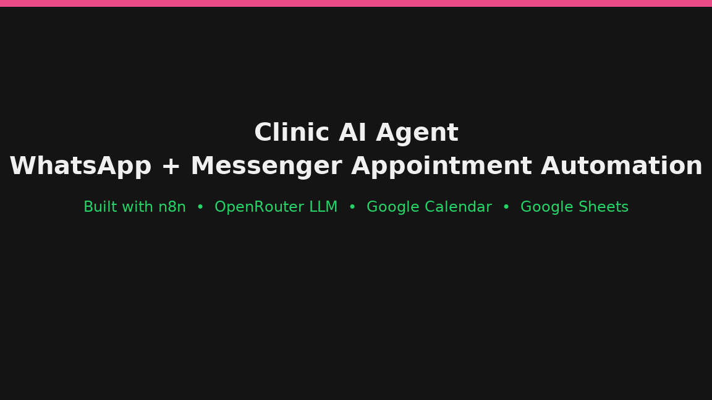
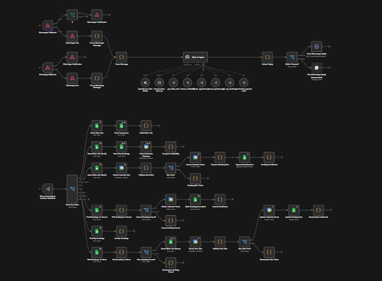
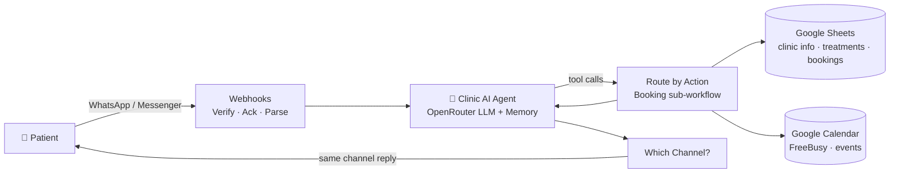

# 🏥 Clinic AI Agent — WhatsApp & Messenger Appointment Automation (n8n)

> **Patients book, reschedule, and cancel clinic appointments just by chatting on WhatsApp or Facebook Messenger.**
> An AI agent in n8n understands the conversation, checks **live** calendar availability, prevents double-booking,
> creates the **Google Calendar** event, logs every booking in **Google Sheets**, and confirms back on the same channel — 24/7, no receptionist needed.



| | |
|---|---|
| 🎬 **Live walkthrough** | ⏳ **[ADD YOUR VIDEO LINK HERE]** — see [`docs/VIDEO_RECORDING_GUIDE.md`](docs/VIDEO_RECORDING_GUIDE.md) (90-second script included) |
| 🕹️ **Interactive demo** | Open [`demo/index.html`](demo/index.html) in any browser — watch a booking flow through every node (4 scenarios) |
| 🖼️ **Full workflow screenshot** | [`assets/workflow-overview.png`](assets/workflow-overview.png) |
| 📥 **Importable workflows** | [`workflows/`](workflows/) — sanitized n8n JSON + export/import guide |
| ✍️ **Case-study write-up** | This README |

---

## The problem

Small clinics lose patients and staff time on appointment admin: phone tag during working hours, double-booked slots,
forgotten cancellations, and no single record of who booked what. Patients, meanwhile, already live on WhatsApp/Messenger.

## The solution — two production n8n workflows



### Workflow 1 — `Clinic AI Agent` (front door + brain)

| Stage | Nodes | What happens |
|---|---|---|
| **Receive** | `Messenger Webhook`, `WhatsApp Webhook` | Meta webhook endpoints for both channels |
| **Verify + Ack** | `IF → Messenger Verification`, `WhatsApp Verification`, `Messenger Ack`, `WhatsApp Ack` | Handles Meta's verification handshake and returns `200 OK` instantly so Meta never retries/times out while the AI thinks |
| **Normalize** | `Parse Messenger Message`, `Parse WhatsApp Message` → `Parse Message` (Code) | Both channel payloads are converted into **one** clean format: `{ channel, senderId, text }` |
| **Think** | `Clinic AI Agent` + `OpenRouter Chat Model` + `Conversation Memory` | LLM agent with per-patient memory; understands free-text requests ("move my cleaning to Thursday afternoon") and picks the right tool |
| **Act** | 6 Workflow Tools → Workflow 2 | `get_clinic_info`, `check_availability`, `book_appointment`, `get_my_bookings`, `cancel_appointment`, `reschedule_appointment` |
| **Reply** | `Extract Reply` → `Which Channel?` (Switch) → `Send Messenger Reply` / `Send WhatsApp Reply` | The answer goes back on the **same channel** the patient used |

### Workflow 2 — Booking sub-workflow (the tool backend)

Triggered by `When Executed by Another Workflow` → **`Route by Action`** (Switch) fans out to one safe, testable branch per action:

| Action | Branch logic | Edge cases handled |
|---|---|---|
| **Clinic info** | `Read Clinic Info` + `Read Treatments` (Sheets) → `Build Clinic Info` | — |
| **Check availability** | `Read Clinic Info (Avail)` → `Read Day Bookings` (Sheets) → `Check Calendar FreeBusy` (Google Calendar) → `Compute Availability` | Combines opening hours, existing Sheet bookings **and** real calendar busy blocks |
| **Book** | `Read Clinic Info (Book)` → `Check Calendar Slot` → `Validate Book Slot` → `Slot Free?` → `Create Calendar Event` → `Prepare Booking Row` → `Append Booking Row` → `Booking Confirmed` | ❌ `Booking Slot Taken` — re-validated at write time, so **two patients can never grab the same slot** |
| **Cancel** | `Find Bookings To Cancel` → `Pick Booking To Cancel` → `Cancel Booking Found?` → `Delete Calendar Event` → `Mark Booking Cancelled` → `Cancel Confirmed` | 🤷 `Cancel Nothing Found` |
| **My bookings** | `Find My Bookings` → `List My Bookings` | Identifies the patient by their channel sender ID |
| **Reschedule** | `Find Bookings To Move` → `Pick Booking To Move` → `Move Booking Found?` → `Read Clinic Info (Move)` → `Check New Slot` → `Validate New Slot` → `New Slot Free?` → `Update Calendar Event` → `Update Booking Row` → `Reschedule Confirmed` | ❌ `Reschedule Slot Taken` · 🤷 `Reschedule Nothing Found` |

**Design principle:** Google Calendar (the schedule staff see) and Google Sheets (the audit/booking log) are **always updated together**, and every write is preceded by a live FreeBusy re-check.



## What a patient experiences

1. *"Hi, any free slot tomorrow morning for a cleaning?"* → agent checks real availability → *"11:00 or 12:00?"*
2. *"11:00, I'm Ahmed"* → slot re-validated → calendar event created + Sheet row appended → *"✅ Booked!"*
3. Later: *"Move it to the afternoon"* / *"Cancel please"* → the agent finds **their** booking, confirms, updates both systems, releases the old slot.

👉 Run the animated version: **[`demo/index.html`](demo/index.html)** (book · slot-taken · reschedule · cancel).

## Tech stack

`n8n` (self-hosted, AI Agent + Workflow Tool nodes) · `OpenRouter` (LLM chat model) · `Meta WhatsApp & Messenger webhooks` · `Google Calendar API (FreeBusy + Events)` · `Google Sheets` · JavaScript Code nodes for parsing, validation and availability logic.

## Results — [REPLACE WITH YOUR REAL NUMBERS BEFORE SHARING]

- ⏱️ Appointment booking handled **24/7** without staff involvement
- 🚫 **Zero double-bookings** since launch thanks to write-time slot validation
- 📈 [ADD: e.g. "≈ XX bookings/month automated" / "response time from hours → seconds"]
- 🗂️ Every booking traceable in one Sheet (patient, treatment, time, status, channel)

## Run it yourself

1. Import both JSON files from [`workflows/`](workflows/) into n8n (**Workflow 2 first**, then point Workflow 1's tools at it).
2. Create credentials (names only — never commit secrets): OpenRouter API key · Google Calendar OAuth · Google Sheets OAuth · Meta Page/WhatsApp access token + verify token.
3. Create the Google Sheet with tabs: `ClinicInfo`, `Treatments`, `Bookings` — columns documented in [`workflows/README.md`](workflows/README.md).
4. Set both production webhook URLs in the Meta app dashboard, activate both workflows, send yourself a test message.

## Repo map

```
n8n-clinic-ai-agent/
├── README.md                  ← this case study (the link to share)
├── assets/
│   ├── workflow-overview.png  ← screenshot of both live workflows
│   └── workflow-demo.gif      ← animated tour (regenerate: scripts/make_gif.py)
├── demo/index.html            ← interactive node-by-node simulation
├── workflows/                 ← sanitized n8n JSON + import & sanitize guide
├── docs/
│   ├── VIDEO_RECORDING_GUIDE.md  ← 5 Loom-free ways to film the REAL system + script
│   └── APPLICATION_COPY_PASTE.md ← ready answers for job applications
└── scripts/make_gif.py
```

## What I'd build next

Appointment reminders (scheduled WhatsApp nudge 24 h before) · no-show follow-up flow · multi-doctor calendars · Arabic/English auto-detect reply language · daily bookings digest to the clinic owner.

---
*Built with n8n. Demo page and GIF use fictitious patients — the live system is shown in the video walkthrough.*
